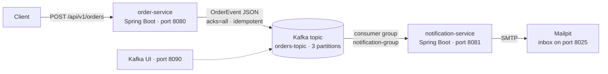

# Spring Kafka — event-driven order processing

[](https://github.com/Zepe237/Spring_Kafka/actions/workflows/ci.yml)


Two Spring Boot microservices that communicate asynchronously through Apache Kafka.
`order-service` exposes a REST API that validates an order and publishes an `OrderEvent`;
`notification-service` consumes those events in a consumer group and emails an order confirmation to the customer.

Personal learning project focused on reliable messaging with Spring for Apache Kafka.

## Architecture



## What it demonstrates

- **Reliable producer**: `acks=all`, retries and idempotence enabled, so an order is written once even if the broker retries.
- **Partitioned topic** created at startup (`orders-topic`, 3 partitions) and a consumer group running 3 listener threads.
- **JSON serialization** of a Java `record` event with Spring Kafka's Jackson serializer, without type headers so producer and consumer stay decoupled.
- **Order confirmation email** sent by the consumer with Spring Mail; Mailpit catches the emails locally.
- **Validated REST API** (Jakarta Validation) documented with OpenAPI / Swagger UI.
- **Integration tests against a real Kafka broker** started by Testcontainers: one test publishes an order and reads it back from the topic, another publishes an event and checks that the confirmation email goes out.
- **Unit tests** for the email content with Mockito.
- **CI** on every push with GitHub Actions.

## Run it locally

Requirements: Java 25 and Docker.

```bash
# 1. Start Kafka (KRaft mode), Kafka UI and Mailpit
docker compose up -d

# 2. Start the two services (two terminals)
cd order-service && ./mvnw spring-boot:run
cd notificatio-service && ./mvnw spring-boot:run

# 3. Place an order
curl -X POST http://localhost:8080/api/v1/orders \
  -H "Content-Type: application/json" \
  -d '{"customerId":"Client-001","customerEmail":"client@example.com","productName":"Pack TCF Gold","quantity":1,"totalAmount":35.00}'
```

The API answers `202 Accepted` with the generated `orderId`. A few moments later the confirmation email appears in the Mailpit inbox.

- Swagger UI: http://localhost:8080/swagger-ui.html
- Kafka UI: http://localhost:8090
- Mailpit inbox: http://localhost:8025

## Run the tests

```bash
cd order-service && ./mvnw verify
cd notificatio-service && ./mvnw verify
```

Docker must be running: Testcontainers starts a throwaway Kafka broker for the tests.

## Tech stack

Java 25 · Spring Boot 4 · Spring for Apache Kafka · Apache Kafka (KRaft) · Spring Mail · Mailpit · Jakarta Validation · springdoc-openapi · Lombok · JUnit 5 · Mockito · Testcontainers · Docker Compose · GitHub Actions

## Next steps

- HTML email template (Thymeleaf)
- Dead-letter topic and retry policy on the consumer
- Shared event contract module between the two services
